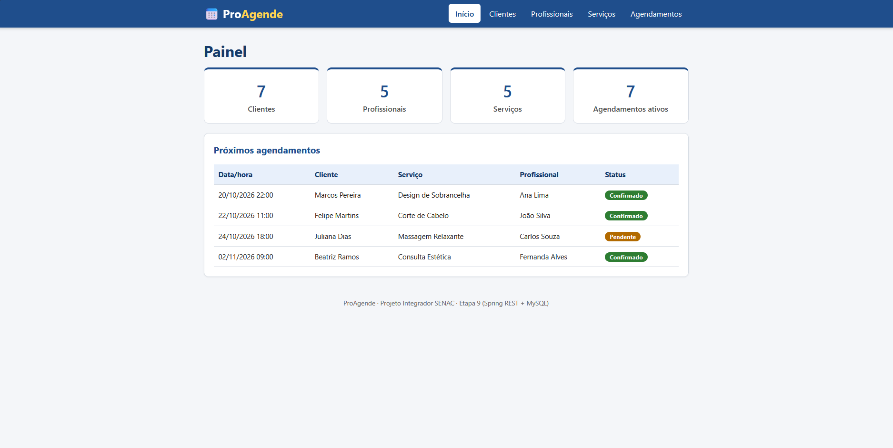
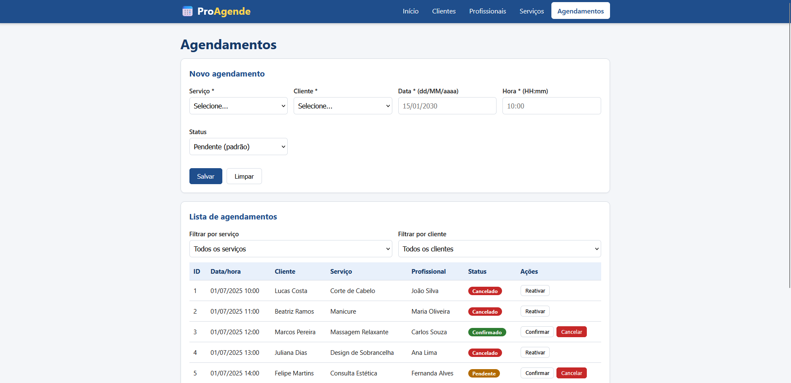
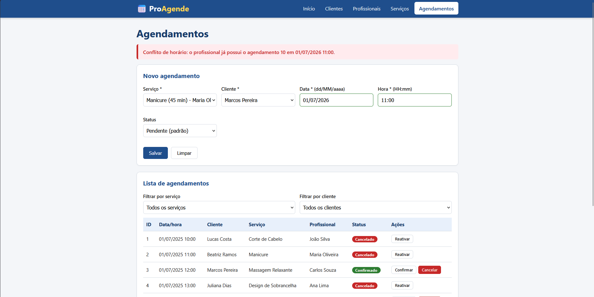
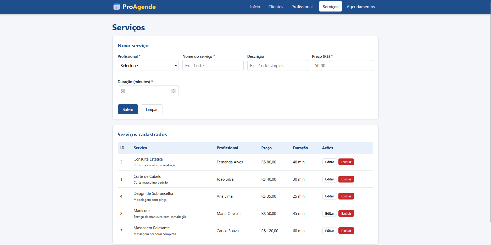
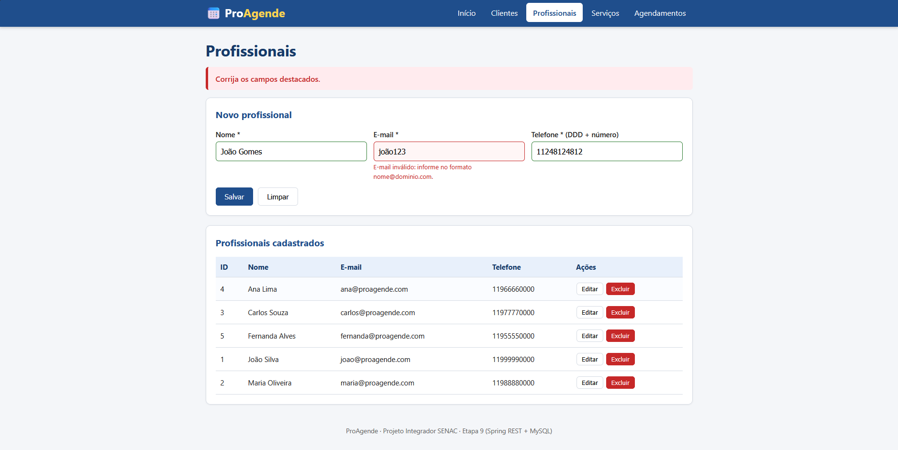
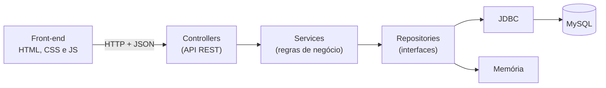
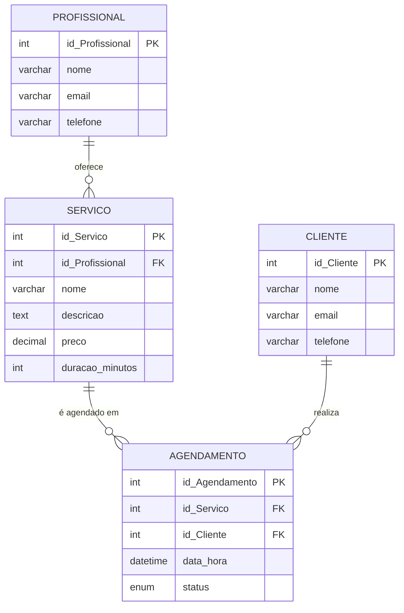
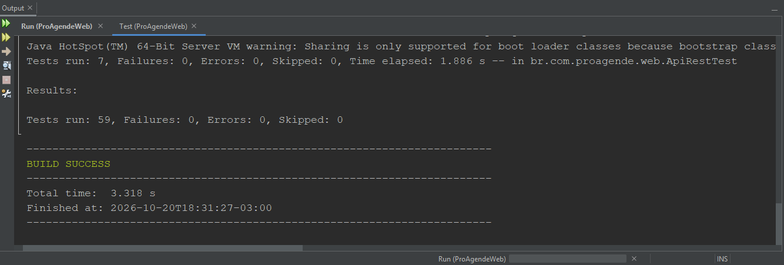

# ProAgendeWeb


Aplicação web para gerenciamento de agendamentos de serviços. Permite cadastrar profissionais, clientes e serviços e criar, confirmar e cancelar agendamentos, com bloqueio automático de conflitos de horário.

O back-end é uma API REST em Spring Boot com persistência em MySQL via JDBC, e o front-end (HTML, CSS e JavaScript) é servido pela própria aplicação.

---

## Sumário

1. [Visão geral](#visão-geral)
2. [Funcionalidades](#funcionalidades)
3. [Telas do sistema](#telas-do-sistema)
4. [Tecnologias utilizadas](#tecnologias-utilizadas)
5. [Arquitetura](#arquitetura)
6. [Modelo de dados](#modelo-de-dados)
7. [API REST](#api-rest)
8. [Como executar](#como-executar)
9. [Testes automatizados](#testes-automatizados)
10. [Autor](#autor)

---

## Visão geral

O ProAgendeWeb é o meu **Projeto Integrador** do curso Técnico em Desenvolvimento de Sistemas do Senac. Ele é a evolução web do **ProAgendeDesktop**, uma aplicação desktop (Java Swing) da fase anterior do projeto: reaproveita as camadas de modelo, serviço, repositório e utilitários, agora expostas por uma API REST e consumidas por uma interface web.

O sistema serve para organizar a agenda de um negócio de serviços (por exemplo, salão de beleza, estética ou massagem), sem permitir que o mesmo profissional seja marcado em dois horários que se sobrepõem.

A evolução do projeto ao longo das etapas do Projeto Integrador:

| Etapa | O que foi feito |
|-------|-----------------|
| Etapa 6 | Refatoração do código desktop em camadas (`model`, `repository`, `service`, `util`), aplicando princípios SOLID. |
| Etapa 7 | Testes automatizados com JUnit. |
| Etapa 8 | Front-end com HTML, CSS e JavaScript. |
| Etapa 9 | Versão web final: API REST com Spring Boot, persistência com JDBC/MySQL, integração com o front-end e os testes. |

---

## Funcionalidades

- **Clientes e profissionais:** cadastro, consulta, edição e exclusão, com validação de nome, e-mail e telefone (DDD + número, 10 ou 11 dígitos).
- **Serviços:** cadastro com nome, descrição (opcional), preço e duração em minutos, sempre vinculado a um profissional.
- **Agendamentos:** criação, consulta, confirmação, cancelamento, reativação e exclusão, com filtro por serviço e por cliente.
- **Controle de conflito de horário:** o sistema calcula o término de cada atendimento (início + duração do serviço) e impede sobreposição para o mesmo profissional. Um atendimento que termina exatamente quando outro começa **não** é conflito, e agendamentos cancelados liberam o horário.
- **Proteção de dados relacionados:** não é possível excluir um profissional que tenha serviços, um serviço que tenha agendamentos, nem um cliente que tenha agendamentos.
- **Painel inicial:** contadores de clientes, profissionais, serviços e agendamentos ativos, além da lista dos próximos agendamentos.
- **Mensagens de erro claras:** as regras de negócio devolvem mensagens em português, exibidas diretamente na tela.
- **Modo em memória:** permite demonstrar o sistema sem instalar o MySQL (os dados não são salvos).

---

## Telas do sistema

### Painel inicial

Visão geral do sistema, com a quantidade de clientes, profissionais, serviços e agendamentos ativos, e a lista dos próximos agendamentos.



### Agendamentos

Formulário de novo agendamento e lista com filtro por serviço e por cliente. Cada agendamento tem status (pendente, confirmado ou cancelado) e botões para confirmar, cancelar ou reativar.



### Bloqueio de conflito de horário

Ao tentar marcar um horário que se sobrepõe a outro atendimento do mesmo profissional, o sistema recusa o agendamento e informa qual agendamento está em conflito.



### Serviços

Cada serviço é vinculado a um profissional e possui descrição, preço e duração em minutos.



### Validação de campos

Os formulários validam os dados antes de salvar. Na imagem, um e-mail em formato inválido é destacado com uma mensagem explicativa na tela de profissionais.



---

## Tecnologias utilizadas

| Tecnologia | Para que é usada no projeto |
|------------|-----------------------------|
| **Java 17** | Linguagem de todo o back-end. |
| **Spring Boot 3.3.4** | Sobe o servidor web e expõe a API REST (controllers). |
| **Maven** | Gerencia dependências e executa o build e os testes. |
| **MySQL 8** | Banco de dados relacional onde as informações são gravadas. |
| **JDBC** | Comunicação direta entre o Java e o MySQL, sem framework de ORM. |
| **JUnit 5** | Testes automatizados de regras de negócio e utilitários. |
| **MockMvc** | Testes de integração da API REST, sem precisar de banco de dados. |
| **HTML, CSS e JavaScript** | Interface web (páginas estáticas que consomem a API com `fetch`). |

---

## Arquitetura

A aplicação é organizada em **camadas**, cada uma com uma responsabilidade bem definida. O front-end conversa com a API REST por JSON, e as regras de negócio ficam isoladas das telas e do banco de dados.



| Camada | Pacote | Responsabilidade |
|--------|--------|------------------|
| Front-end | `static/` | Páginas, estilos e scripts; chama a API em `/api/...`. |
| Web | `web` | Controllers REST, DTOs (formato do JSON) e tratamento de erros (`TratadorErros`). |
| Serviço | `service` | Regras de negócio: validações, status padrão, conflito de horário e bloqueio de exclusões. |
| Repositório | `repository` | Interfaces de acesso a dados, com duas implementações: `jdbc` (MySQL) e `memoria`. |
| Modelo | `model` | Entidades do domínio (`Cliente`, `Profissional`, `Servico`, `Agendamento`) e o enum `StatusAgendamento`. |
| Utilitários | `util` | Validações (`Validador`), conversão de datas (`DataHoraUtil`) e cálculos de agenda (`CalculoAgenda`). |
| Configuração | `config` | Conexão com o banco (`ConexaoBanco`, que implementa `FabricaConexao`). |

### Decisões de projeto

- **Repositórios como interfaces:** os services dependem de uma interface, não do MySQL. Por isso é possível trocar JDBC por memória apenas com a configuração `proagende.memoria`.
- **Injeção de dependência por construtor:** a classe `ProAgendeApp` monta os repositórios e services, e o Spring os entrega aos controllers como beans.
- **Credenciais fora do código:** usuário e senha do banco vêm de variáveis de ambiente ou de um arquivo local ignorado pelo Git.
- **Tratamento centralizado de erros:** exceções de regra de negócio viram respostas HTTP 400 com mensagem; falhas de banco viram HTTP 500.

### Estrutura de pastas

```
ProAgendeWeb/
├── banco/
│   └── ProAgende_estrutura_e_dados.sql    # criação das tabelas e dados de exemplo
├── docs/
│   └── images/                            # capturas de tela usadas neste README
├── src/
│   ├── main/
│   │   ├── java/br/com/proagende/
│   │   │   ├── config/                    # conexão com o banco
│   │   │   ├── exception/                 # exceções do sistema
│   │   │   ├── model/                     # entidades e enum de status
│   │   │   ├── repository/                # interfaces
│   │   │   │   ├── jdbc/                  # implementação MySQL
│   │   │   │   └── memoria/               # implementação em memória
│   │   │   ├── service/                   # regras de negócio
│   │   │   ├── util/                      # validações e cálculos
│   │   │   ├── web/                       # controllers, DTOs e tratador de erros
│   │   │   ├── ProAgendeApp.java          # montagem das dependências
│   │   │   └── ProAgendeWebApplication.java  # ponto de entrada (Spring Boot)
│   │   └── resources/
│   │       ├── static/                    # front-end (HTML, css/, js/)
│   │       ├── application.properties
│   │       └── banco.properties.example   # modelo de configuração do banco
│   └── test/java/br/com/proagende/        # testes automatizados
├── pom.xml
└── README.md
```

---

## Modelo de dados



O status de um agendamento pode ser `pendente` (padrão), `confirmado` ou `cancelado`.

---

## API REST

Todas as rotas ficam sob `/api` e trocam dados em JSON.

| Recurso | Rotas |
|---------|-------|
| Clientes | `GET /api/clientes` · `GET /api/clientes/{id}` · `POST` · `PUT /{id}` · `DELETE /{id}` |
| Profissionais | `GET /api/profissionais` · `GET /api/profissionais/{id}` · `POST` · `PUT /{id}` · `DELETE /{id}` |
| Serviços | `GET /api/servicos` · `GET /api/servicos/{id}` · `POST` · `PUT /{id}` · `DELETE /{id}` |
| Agendamentos | `GET /api/agendamentos` (filtros opcionais `?servico=` e `?cliente=`) · `GET /{id}` · `POST` · `PATCH /{id}/status` · `DELETE /{id}` |

**Exemplo: criar um agendamento**

```http
POST /api/agendamentos
Content-Type: application/json

{
  "idServico": 1,
  "idCliente": 1,
  "dataHora": "2026-10-21T10:00",
  "status": "pendente"
}
```

A data e hora usam o formato `aaaa-MM-ddTHH:mm` (horário local). Se o `status` for omitido, o agendamento é criado como `pendente`.

**Exemplo: confirmar um agendamento**

```http
PATCH /api/agendamentos/1/status
Content-Type: application/json

{ "status": "confirmado" }
```

**Formato dos erros**

Quando uma regra de negócio é violada (por exemplo, conflito de horário ou e-mail inválido), a API responde com **HTTP 400** e uma mensagem:

```json
{ "mensagem": "E-mail inválido: ana@" }
```

Falhas de acesso ao banco retornam **HTTP 500** no mesmo formato.

---

## Como executar

### Pré-requisitos

- JDK 17
- MySQL 8
- NetBeans com suporte a Maven (ou Maven instalado, para uso pelo terminal)

### Passo a passo no NetBeans

**1. Crie o banco de dados.** Execute o script `banco/ProAgende_estrutura_e_dados.sql` no MySQL (por exemplo, pelo MySQL Workbench). Ele cria o banco `ProAgende`, as tabelas e alguns dados de exemplo.

> **Atenção:** se o banco já existir e você precisar recriá-lo, faça um backup antes, pois essa operação pode apagar os dados existentes.

**2. Configure a conexão com o MySQL.** Escolha **uma** das opções:

- **Arquivo de configuração:** copie `src/main/resources/banco.properties.example` para `src/main/resources/banco.properties` e preencha usuário e senha:

  ```properties
  db.url=jdbc:mysql://localhost:3306/ProAgende
  db.user=root
  db.password=sua_senha
  ```

- **Variáveis de ambiente:** em vez de criar o arquivo, defina `PROAGENDE_DB_URL`, `PROAGENDE_DB_USER` e `PROAGENDE_DB_PASSWORD` com o endereço do banco, o usuário e a senha.

**3. Abra o projeto.** No NetBeans, use **File > Open Project** e selecione a pasta do projeto.

**4. Compile e execute.** Rode **Clean and Build** e, em seguida, **Run**.

**5. Acesse a aplicação** em [http://localhost:8080](http://localhost:8080).

### Executar sem MySQL (modo em memória)

Para demonstrar o sistema sem banco de dados, altere em `src/main/resources/application.properties`:

```properties
proagende.memoria=true
```

Nesse modo, os dados ficam apenas na memória e **são perdidos ao reiniciar** a aplicação. Nada é gravado no MySQL.

---

## Testes automatizados

O projeto possui **59 testes automatizados**, que não dependem do MySQL:

| Tipo | Classe de teste | O que verifica |
|------|-----------------|----------------|
| Unitário | `CalculoAgendaTest` | Cálculo de término do atendimento e detecção de sobreposição de horários. |
| Unitário | `ValidadorTest` | Regras de validação de campos. |
| Unitário | `DataHoraUtilTest` | Conversão e formatação de data e hora. |
| Unitário | `StatusAgendamentoTest` | Conversão do status entre banco e enum. |
| Serviço | `AgendamentoServiceTest` | Status padrão, conflitos de horário, liberação de horário cancelado e cliente inexistente. |
| Integração | `ApiRestTest` | Rotas da API com MockMvc: cadastro, validações com HTTP 400, exclusão bloqueada e agendamento com conflito. |

**Pelo NetBeans:** clique com o botão direito no projeto e selecione **Test**.

**Pelo terminal**, na pasta do projeto:

```bash
mvn test
```

Resultado da execução dos testes no NetBeans:



---

## Autor

**Igor Pereira Lima** · [@igor-plima](https://github.com/igor-plima)

Projeto Integrador · Curso Técnico em Desenvolvimento de Sistemas · Senac
